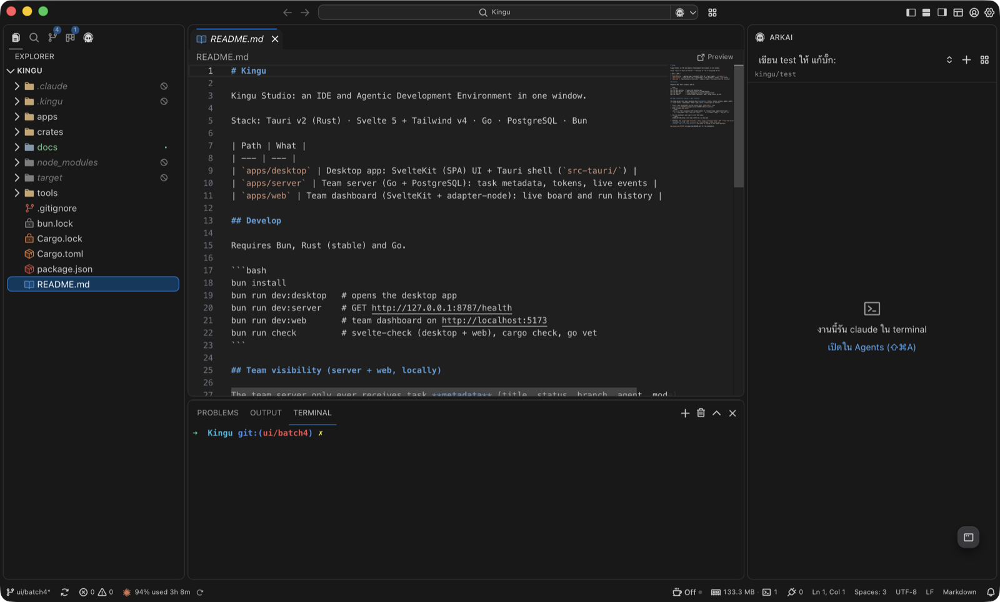
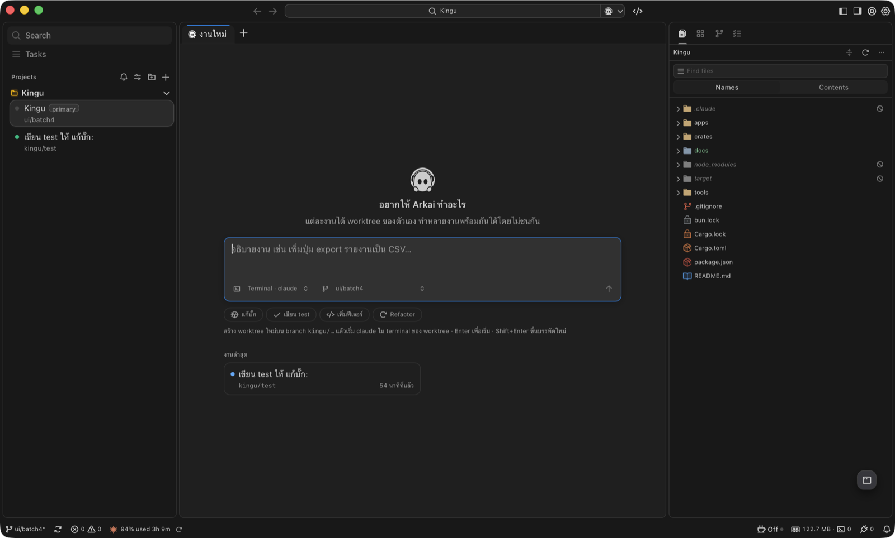
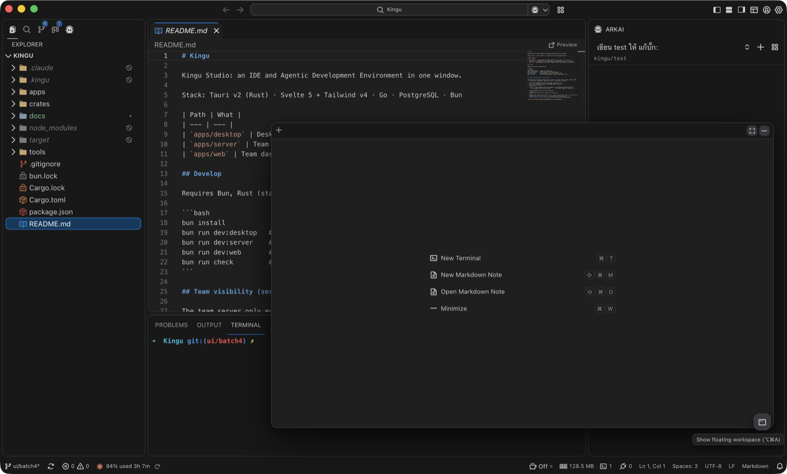
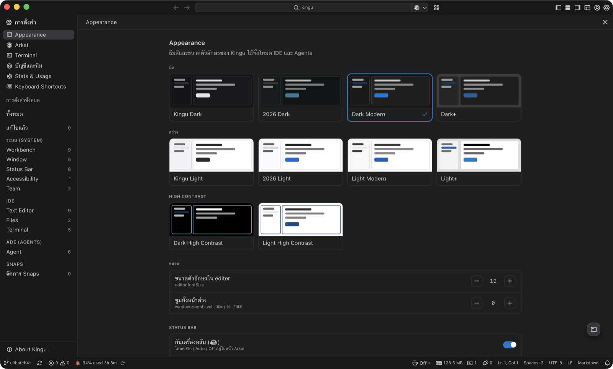

# Kingu

**Kingu Studio** is an IDE and an Agentic Development Environment (ADE) in one window: a
VS Code–style editor for hands-on work, plus a workspace for running coding agents in their
own git worktrees, reviewing their changes and shipping them as pull requests.



## Features

**IDE**
- Monaco editor with TextMate themes, tabs, splits, minimap and Markdown preview
- Explorer, search, source control, extensions and an integrated terminal (xterm)
- VS Code–style status bar: branch picker, sync/publish, problems, cursor and selection,
  indentation, encoding, line endings and language pickers
- Arkai assistant panel beside the editor
- Phosphor icon set throughout the UI

**ADE (Agents)**
- One task per git worktree, with an Orca-style sidebar of projects and workspaces
- Right sidebar: Explorer, Agents (task and Claude Code sessions with resume and hand-off),
  Source Control (commit with AI message, push/pull/sync/rebase, commit graph and diffs,
  PR composer, conflict resolution), Checks (PR status, merge, check logs, review threads)
- Floating workspace (⌥⌘A): a terminal and Markdown notes that float over any view
- Claude and Codex usage in the status bar, with a detailed usage popover

**Settings**
- Themes (Kingu, 2026, Modern, Plus and High Contrast, dark and light), font size and zoom
- Searchable settings for every feature, keyboard shortcuts, and Stats & Usage

| ADE | Floating workspace |
| --- | --- |
|  |  |



## Project layout

Stack: Tauri v2 (Rust) · Svelte 5 + Tailwind v4 · Go · PostgreSQL · Bun

| Path | What |
| --- | --- |
| `apps/desktop` | Desktop app: SvelteKit (SPA) UI + Tauri shell (`src-tauri/`) |
| `apps/server` | Team server (Go + PostgreSQL): task metadata, tokens, live events |
| `apps/web` | Team dashboard (SvelteKit + adapter-node): live board and run history |

## Develop

Requires Bun, Rust (stable) and Go.

```bash
bun install
bun run dev:desktop   # opens the desktop app
bun run dev:server    # GET http://127.0.0.1:8787/health
bun run dev:web       # team dashboard on http://localhost:5173
bun run check         # svelte-check (desktop + web), cargo check, go vet
```

## Team visibility (server + web, locally)

The team server only ever receives task **metadata** (title, status, branch, agent, model,
+/- line counts, timestamps). Never code, diffs, transcripts or secrets.

1. Start a dev PostgreSQL and the server with `KINGU_DEV=1` (see
   [apps/server/README.md](apps/server/README.md#run-locally)).
2. Mint a token (dev only):
   ```bash
   curl -s -X POST localhost:8787/v1/dev/tokens -H 'Content-Type: application/json' \
     -d '{"org_name":"dev","user_id":"you"}'      # → {"token":"kgu_…", "org_id": …}
   ```
3. Run the dashboard and sign in with the token:
   ```bash
   KINGU_API_URL=http://127.0.0.1:8787 bun run dev:web
   ```
4. Desktop: set `kingu.team.serverUrl` (e.g. `http://localhost:8787`) and `kingu.team.project`
   (a project id from `POST /v1/projects`) in Settings → Team, then run
   **Kingu: Sign in to Team Server**. The token is stored in the macOS Keychain.

See [apps/web/README.md](apps/web/README.md) for the dashboard.

## ภาษาไทย

**Kingu Studio** คือ IDE และ ADE (Agentic Development Environment) ในหน้าต่างเดียว
มีตัวแก้ไขโค้ดแบบ VS Code สำหรับเขียนโค้ดเอง และพื้นที่สำหรับสั่งงาน coding agent
ให้ทำงานใน git worktree ของตัวเอง ตรวจทานการเปลี่ยนแปลง แล้วส่งออกเป็น pull request

**ความสามารถหลัก**
- **IDE:** Monaco editor, ธีม TextMate, Explorer, ค้นหา, Source Control, Terminal ในตัว,
  status bar แบบ VS Code (เลือก branch, sync, problems, indentation, encoding, EOL, ภาษา)
  และแผง Arkai ข้างตัวแก้ไข
- **ADE:** หนึ่งงานต่อหนึ่ง worktree, sidebar แบบ Orca, แถบขวามี Explorer, Agents
  (เซสชันของงานและ Claude Code พร้อม resume/hand off), Source Control (commit พร้อมข้อความจาก AI,
  push/pull/sync/rebase, กราฟ commit, สร้าง PR, แก้ conflict) และ Checks (สถานะ PR, merge,
  log ของ check, review thread)
- **Floating workspace** (⌥⌘A): terminal และโน้ต Markdown ที่ลอยอยู่เหนือทุกหน้า
- **Usage:** แสดงการใช้งาน Claude และ Codex ใน status bar พร้อม popover รายละเอียด
- **Settings:** ธีมมืด/สว่าง/High Contrast, ขนาดตัวอักษร, ซูม, คีย์ลัด และ Stats & Usage

**เริ่มพัฒนา:** ต้องมี Bun, Rust (stable) และ Go จากนั้นรัน `bun install` และ
`bun run dev:desktop` (ดูหัวข้อ Develop ด้านบน)

## License

Copyright 2026 Anthovai. Licensed under the [Apache License, Version 2.0](LICENSE).
Third-party notices are listed in [NOTICE](NOTICE).

สัญญาอนุญาต: Apache License 2.0 ลิขสิทธิ์ © 2026 Anthovai
